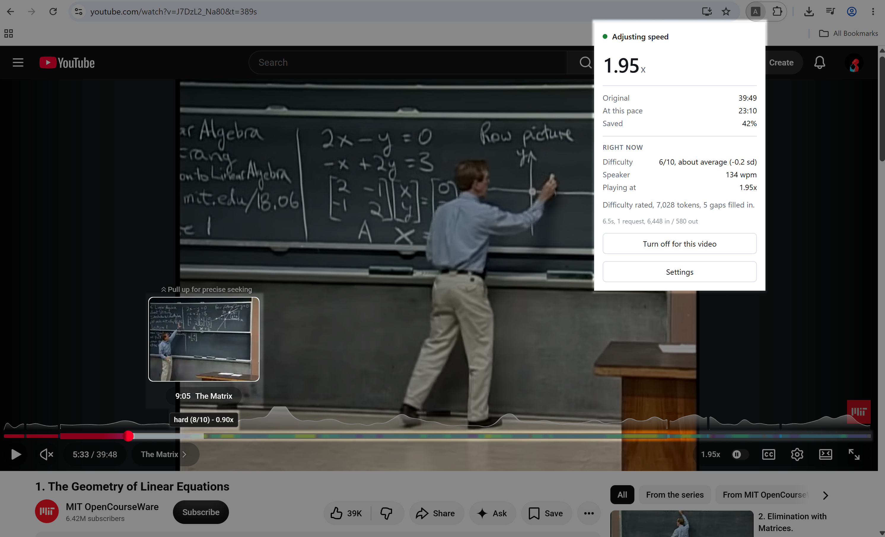
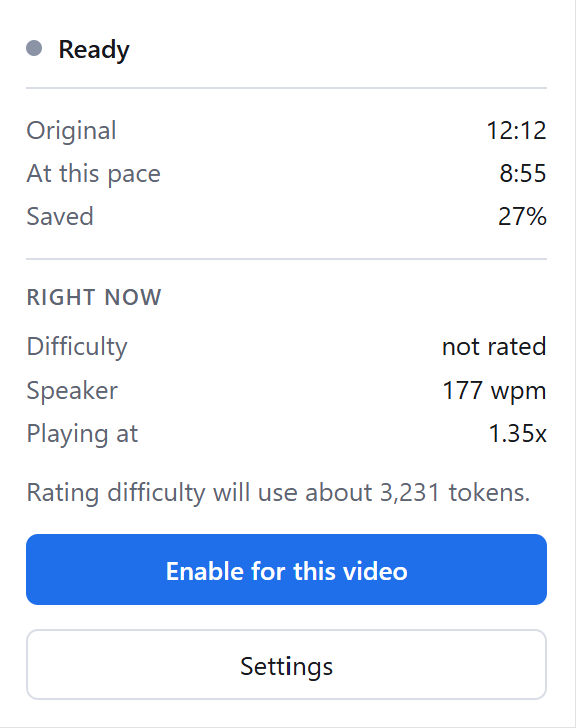
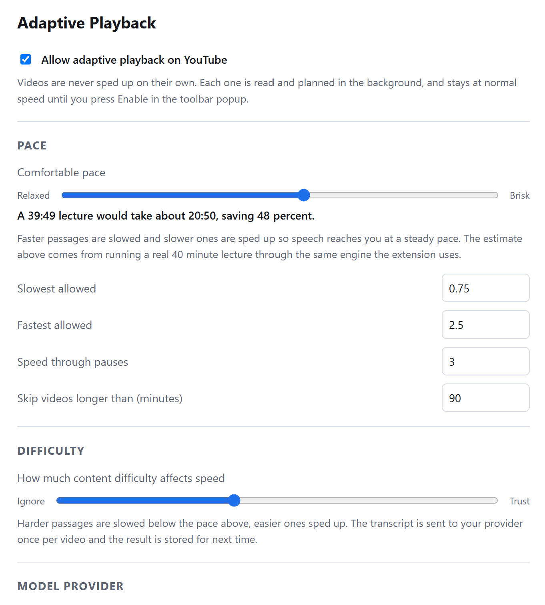

# AdaptivePace - Adaptive Playback




A Chrome extension that changes YouTube playback speed moment to moment based on how dense the
content is, so the effort of watching stays about the same the whole way through.

Lectures are not uniformly hard. Intros, recaps, and tangents are light. Derivations and
definitions are not. One speed multiplier is wrong for most of a video, and fixing it by hand
takes away focus. This speeds up the easy parts and slows down the
hard parts for you.


## Installing

There is no Chrome Web Store listing yet, so it loads unpacked.

```
npm install
npm run build
```

1. Open `chrome://extensions`
2. Turn on **Developer mode** in the top right
3. Click **Load unpacked** and pick the `dist/` folder
4. Open any YouTube video and click the extension icon


Speed pacing works immediately and needs no setup. The difficulty rating is optional and needs
an API endpoint, which you set in the extension options.

## How it works

Two signals decide the speed at each point in the video.

**Speech rate** comes from the transcript's word timings. It is free and needs no API key.

**Conceptual difficulty** comes from a language model rating the transcript in chunks. This
catches what speech rate misses, since a slow careful derivation is still hard.

The two combine into a target reading rate rather than a target multiplier:

```
ln(speed) = ln(targetWpm) - ln(nativeWpm) - alpha * difficultyZ
```

Working in log space keeps the speed changes proportional, so a step from 1.5x to 1.6x feels
like the same size change as 2.5x to 2.7x. Difficulty is z-scored within a single video, so a
section is judged hard relative to the rest of that video and not against some global scale.

The result is a plan of speed segments, applied to the player as it plays and drawn on the
progress bar as a colour ribbon.


Speech rate pacing alone is a complete working product with no API key, and it is the baseline
the model layer has to beat.

## Using it

Opening a video does nothing to it. Playback stays normal until you press **Enable for this
video** in the popup. Before you press it, the popup shows how long the video will take at your
pace.



Enabling applies to that one video and is forgotten when you navigate away, so nothing runs
without a deliberate click. Ratings are cached on your machine and reused when you rewatch, so
a video is never paid for twice.



> The extension also provides a settings panel where various settings included min/max speed and LLM API key can be configured.


## Built with

TypeScript, Chrome Extensions (Manifest V3), esbuild, Node.js, IndexedDB, OpenAI API.

---

## Privacy

Nothing leaves the browser except the requests you configure.

When you enable a video and have a rating endpoint set up, that video's transcript is sent to
the endpoint you chose, once. Nothing is sent for a video you have not enabled. Your API key is
stored locally, read only by the service worker, and never syncs to a Google server.

